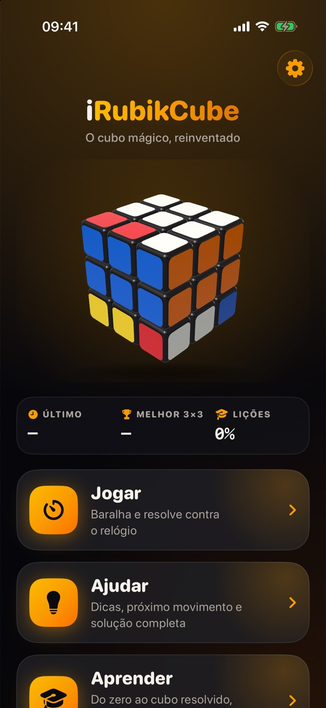

# 🧊 iRubikCube

> The classic Rubik's Cube, natively reimagined for iOS and iPadOS with SwiftUI and RealityKit.

[](https://github.com/VidiPT89/iRubikCube/issues)
[](https://github.com/VidiPT89/iRubikCube/issues)
[](https://github.com/VidiPT89/iRubikCube/actions/workflows/ci.yml)

<p align="center">
  
</p>

## ✨ Features

- ✅ Fully 3D cube rendered with RealityKit: bevelled pieces, glossy stickers, soft lighting and contact shadows
- ✅ Natural gestures: drag a sticker to turn a layer, drag outside to orbit, pinch to zoom, double tap to reset the view
- ✅ Layers follow your finger in real time and snap into place with spring animations
- ✅ Three modes: **Play**, **Assist** and **Learn**
- ✅ Play mode: WCA-style scrambles, speedcubing timer with optional 15-second inspection, move counter, undo and redo
- ✅ 2×2, 3×3 and 4×4 cubes in Play mode
- ✅ Assist mode: next-move hints with animated 3D arrows, "do it for me", full step-by-step solution playback and "where am I" stage detection
- ✅ Near-optimal solver (Kociemba two-phase, pure Swift) plus a beginner-method solver with explained steps
- ✅ Camera scanner: read a real cube face by face, fix any sticker by tapping it, and get the solution for your physical cube
- ✅ Learn mode: interactive course from cube anatomy and notation to the full layer-by-layer beginner method, plus an introduction to CFOP (F2L, 2-look OLL, 2-look PLL)
- ✅ Guided practice with real-time feedback on every move
- ✅ Statistics: best time, Ao5, Ao12 and history charts
- ✅ Daily challenge and achievements
- ✅ Celebration effects, synthesized sound effects and custom Core Haptics patterns
- ✅ iCloud sync for settings and lesson progress
- ✅ Adaptive layout for iPhone and iPad, portrait and landscape
- ✅ Animated splash screen with developer credits, then straight into the main screen
- ✅ Runtime language switch: Português (PT-PT) and English, independent of the system locale
- ✅ Dark mode, Light mode and System mode
- ✅ Colour identity taken from [ividi.dev](https://ividi.dev/): burnt orange, amber and near-black
- ✅ Accessibility: VoiceOver, Dynamic Type, Reduce Motion and a high-contrast colour-blind cube scheme

## 🛠️ Tech Stack

| Category     | Technology                                  |
| ------------ | ------------------------------------------- |
| Language     | Swift 6                                     |
| UI           | SwiftUI                                     |
| 3D           | RealityKit                                  |
| Architecture | MVVM + UI-free cube core                    |
| Solver       | Kociemba two-phase + beginner method        |
| Persistence  | SwiftData                                   |
| Sync         | iCloud key-value storage                    |
| Camera       | AVFoundation + Vision                       |
| Charts       | Swift Charts                                |
| Audio        | AVAudioEngine (synthesized, no audio files) |
| Haptics      | Core Haptics                                |
| Project      | XcodeGen                                    |
| Min. iOS     | 18.0                                        |

## 🚀 Quick Start

### Prerequisites

- macOS with Xcode 16+
- iOS 18+ Simulator or device (iPhone or iPad)
- A physical device is needed for the camera scanner

### Installation

```bash
git clone https://github.com/VidiPT89/iRubikCube.git
cd iRubikCube
open iRubikCube.xcodeproj
```

Build and run (`⌘R`) on the simulator or a connected device.

> The Xcode project is generated with [XcodeGen](https://github.com/yonaskolb/XcodeGen) from `project.yml`. If you add or move Swift files, regenerate it with `xcodegen generate`.

## 📖 Usage

1. Pick a mode on the main screen: **Play**, **Assist** or **Learn**
2. **Play:** tap *Scramble*, inspect the cube, and the timer starts on your first move
3. **Assist:** ask for a hint, let the app make the next move, or watch the full solution step by step
4. **Learn:** follow the lessons in order, from notation to the full beginner method
5. **Scanner:** point the camera at each face of your real cube and follow the solution

Language, appearance, animation speed, inspection time, sound, haptics and cube colour scheme are all adjustable in Settings.

## 🎮 Controls

| Input                      | Action                        |
| -------------------------- | ----------------------------- |
| Drag a sticker             | Turn that layer               |
| Drag outside the cube      | Rotate the whole cube         |
| Pinch                      | Zoom in and out               |
| Double tap                 | Reset the camera view         |
| Notation panel buttons     | Apply a move (R, U', F2, …)   |
| Undo / Redo buttons        | Step back and forward         |

## 🔤 Notation

| Move       | Meaning                                         |
| ---------- | ----------------------------------------------- |
| R L U D F B | Turn the right, left, up, down, front or back face 90° clockwise |
| `'` (prime) | Turn counter-clockwise (e.g. `R'`)             |
| `2`        | Turn 180° (e.g. `U2`)                           |
| M E S      | Turn a middle slice                             |
| x y z      | Rotate the whole cube                           |

## 🧪 Testing

```bash
xcodebuild -project iRubikCube.xcodeproj -scheme iRubikCube \
  -destination 'platform=iOS Simulator,name=iPhone 17 Pro' test
```

## Reliability and validation

The timer and inspection countdown use a monotonic clock. If the app resumes after
the inspection deadline, timing catches up from that deadline. Daily results stay
attached to the original challenge date even when completed after midnight. Saved solutions retain whole-cube rotations
(including inspection rotations), so the recorded sequence can reproduce the solve.
Restarting a round or changing lessons cancels delayed results and quiz actions.

The test suite covers cube moves, notation, validation, both solvers (including
1,000 scrambled 3×3 solves), gestures, round lifecycle, solution replay, learning,
progress and localisation. Release builds can also be checked without signing:

```bash
xcodebuild -project iRubikCube.xcodeproj -scheme iRubikCube \
  -configuration Release -destination 'generic/platform=iOS' \
  CODE_SIGNING_ALLOWED=NO build
```

Settings and learning progress sync through iCloud key-value storage. Solve history
is local SwiftData storage. Resetting statistics also syncs a reset marker, so old
daily times cannot reappear when another device reconnects. Devices should run the
updated app to share this reset behaviour. Play supports 2×2, 3×3 and 4×4; the scanner and the
solvers work with 3×3 cubes. Scrambles use random moves, not official competition
random-state generation, and inspection does not apply +2/DNF penalties.

Camera accuracy with a physical cube, gesture feel, audio interruptions, haptics
and iCloud sync between signed-in devices still require physical-device testing.

## 📄 License

Distributed under the MIT License. See [LICENSE](LICENSE) for details.

## 👨‍💻 Author

**David Arsénio Martins**

- 🌐 Website: [ividi.dev](https://ividi.dev/)
- 🐙 GitHub: [@VidiPT89](https://github.com/VidiPT89/)

## 🤝 Contributing

Contributions, issues and feature requests are welcome. Feel free to check the [issues page](https://github.com/VidiPT89/iRubikCube/issues).

---

Developed by [David Arsénio Martins](https://ividi.dev)

⭐ If you like this project, give it a star!
